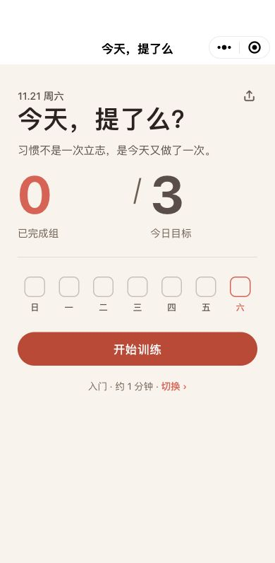
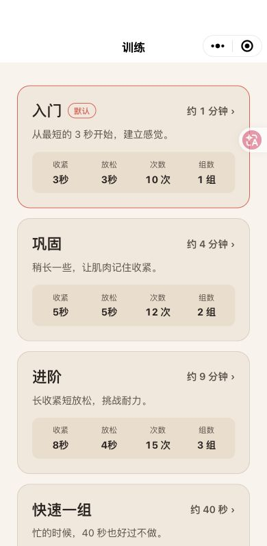
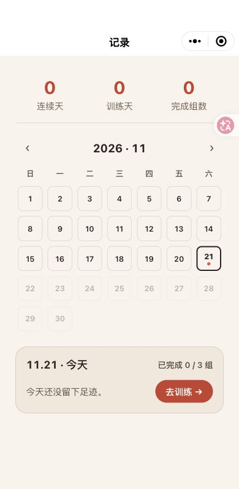

<p align="center">
  
</p>

<h1 align="center">今天提了么 (Tilemo)</h1>

<p align="center">
  每日提肛（凯格尔 / 盆底肌训练）打卡与引导训练工具。<strong>离线 · 本地 · 私密</strong>。
</p>

<p align="center">
  <a href="https://github.com/chen893/tilemo/stargazers"></a>
  
  <a href="https://tilemo-web.vercel.app/"></a>
  <a href="https://linux.do" alt="LINUX DO"></a>
</p>

项目包含网页端、React Native 移动 App、微信小程序和原生鸿蒙端。

## 宣传视频

32 秒竖屏卡点宣传片（1080×1920 · 节奏音乐 + 抽象小熊猫互动 + 真机演示）：

<p>
  <a href="./docs/promo/tilemo-promo-vertical-1080x1920.mp4">
    
  </a>
</p>

- [观看 / 下载宣传视频（MP4，32s 竖屏版）](./docs/promo/tilemo-promo-vertical-1080x1920.mp4)

## 微信小程序体验版

「今天提了么」已新增微信小程序端。可以跟着节拍训练，查看每日进度和历史记录。训练记录保存在本机。

**目前是体验版，还未正式上架。** 用微信扫描下方二维码试用。


小程序界面预览

<p>
  
  
  
</p>

## 结构

```
tilemo/
├─ apps/
│  ├─ web/            # 网页端 — Vite + 原生 JS(从 index.html 1:1 移植的双壳:移动 <1024 + 桌面 ≥1024)
│  ├─ mobile/         # 移动 app — Expo / React Native(4 tab + 节拍器)
│  ├─ miniprogram/    # 原生微信小程序
│  └─ harmony/       # 鸿蒙端 — ArkTS + ArkUI
├─ packages/
│  ├─ data/           # Store + StorageAdapter + tgm: 数据模型(两端共用,localStorage / AsyncStorage)
│  ├─ core/           # Metro 节拍引擎 + 域数学(heatLevel/recomputeStreak/recordSession)+ QUOTES
│  ├─ design-tokens/  # 视觉 token 单一源(浅/深,RN 直读 TS,web 注入 CSS 变量)
│  └─ store/          # Zustand 响应层(移动端用)
├─ index.html         # 迁移前的原始单文件(保留为参照,勿改)
└─ turbo.json / pnpm-workspace.yaml
```

## 开发

需要 Node ≥ 20、pnpm 10。

```bash
pnpm install

# 网页端(默认 http://localhost:5173)
pnpm --filter @tilemo/web dev

# 移动 app(Expo,扫码或模拟器)
pnpm --filter @tilemo/mobile dev

# 全量校验
pnpm build        # web 构建 + 移动 iOS/Android bundle
pnpm typecheck    # 全工作区 tsc
pnpm test         # vitest(data + core)
pnpm check:miniprogram # 小程序冒烟测试和边界检查
```

鸿蒙端通过 DevEco 独立构建。见 [鸿蒙开发与验收](./apps/harmony/README.md)。

## 数据

全部存设备本地,键名前缀 `tgm:`(`tgm:settings` / `tgm:plans` / `tgm:streak` / `tgm:log:YYYY-MM-DD`)。
网页端用 localStorage，移动端用 AsyncStorage，微信小程序用微信本地存储，鸿蒙端用 Preferences。网页端读取既有 `tgm:` 数据**向后兼容**。
不联网、不登录、不上传。

## 部署

见 [DEPLOY.md](./DEPLOY.md):GitHub Actions 打包移动 app(EAS Build)+ Vercel 部署网页端。

## 后续规划

见 [多端方案与微信云服务调研](./docs/multi-platform-roadmap.md)，了解三端共用云数据的可行性、账号与同步方案，以及排行榜、对战和日常提醒的分阶段待办。

## 备注

- `index.html`(仓库根)是迁移前的原始单文件应用,迁移期的**唯一参照物**;正式产物是 `apps/web`。
- 移动端的节拍音暂为 stub(RN 无 Web Audio);视觉 + 触感已实现。

## 许可证

[MIT](./LICENSE)
