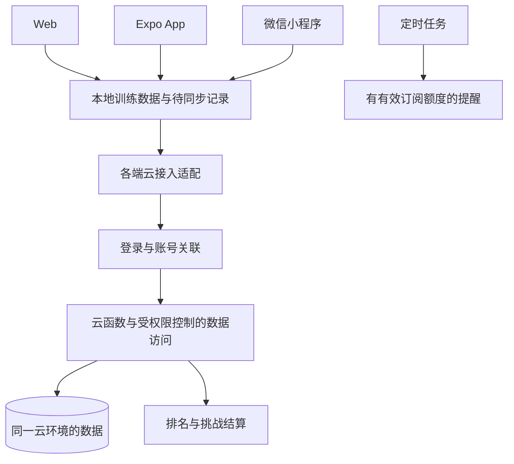

# 多端方案与微信云服务调研

更新日期：2026-11-15。代码基线：`main`，`2cfb58501213b30f3308c76cd190644b7bc3f476`。

本文记录后续开发方向、技术判断和待办。平台能力来自官方文档；方案建议尚未实现。当前没有创建云环境，也没有做三端联网实测。

## 1. 这次要解决的问题

目前已有 Web 和移动 App，但数据只保存在各自设备上，没有账号、云端数据库或跨端同步。Web 部署在 Vercel，社区反馈有人分享到家人群后无法打开。

下一步探索新增微信小程序，把它作为国内用户的入口，并评估使用微信云开发与腾讯云 CloudBase 提供托管数据库和服务端能力，减少自行购买、部署和维护数据库的工作。

后续候选功能包括对战、排行榜和日常提醒。先验证三端共用后端与账号，再决定这些功能的具体范围。社区里的对战讨论包含大量玩笑，适合作为需求线索，不能直接视为实际使用意愿。

新增小程序解决的是一个访问入口。现有 Web 的国内可达性仍需单独处理，接入国内数据库不会自动改变网页的部署位置。

## 2. 现有代码可以复用什么

以下以源码为准，README 中部分技术描述已落后于实现。

| 位置 | 当前实现 | 对新增小程序的意义 |
| --- | --- | --- |
| `apps/web` | React + Vite，数据入口为 `src/data.ts` | 保留现有桌面和移动网页体验 |
| `apps/mobile` | Expo + React Native，工程支持 iOS 和 Android | 可以接入共同后端，实际发版情况需另行核对 |
| `packages/core` | 训练节拍器、打卡、连续天数和统计逻辑 | 优先复用，平台动画、音频和生命周期另做适配 |
| `packages/data` | `Store`、同步存储接口和数据模型 | 可接小程序本地存储；云同步需要独立的异步流程 |
| `packages/store` | Zustand 状态层 | 通过小程序构建验证后复用 |
| `packages/design-tokens` | 颜色和其他设计参数 | 共享视觉参数，组件渲染分别实现 |
| `packages/share-card` | 分享卡片的数据组装和文案 | 复用数据准备，Canvas 与保存分享适配小程序 |

Web 使用 `localStorage`，App 在启动时从 `AsyncStorage` 预载数据，再通过同步内存接口读写。现有键包括 `tgm:settings`、`tgm:plans`、`tgm:streak` 和 `tgm:log:YYYY-MM-DD`。

当前 `Session` 只有时间、计划、完成次数、时长和完成状态，没有稳定记录 ID 或同步版本。后续必须补齐去重与迁移设计，不能直接把按天保存的整个 JSON 互相覆盖。

本轮只新增规划文档，不修改上述行为。历史文件 `MIGRATION_GOAL.md` 描述的是此前的迁移任务；本轮后续工作的入口是本文。

## 3. 微信云服务能否让其他平台访问数据

结论是平台具备跨端接入能力，可以作为共同后端的候选。实际选定的微信云开发环境能否按预期开放给三端，需要用同一个环境 ID 验证。

CloudBase 的官方 JavaScript SDK 文档列出了 Web、微信小程序和 React Native 等运行环境，官方也提供 RN 接入指南和 HTTP 调用方式。[S1][S2][S3]

| 端 | 候选接入方式 | 开发前必须确认 |
| --- | --- | --- |
| 微信小程序 | 微信云开发 SDK，或目标环境支持的 CloudBase 小程序接入方式 | 小程序与环境关联、可信身份来源、数据库权限 |
| Web | CloudBase JS SDK；需要时使用带用户鉴权的 HTTP 接口 | 环境开放设置、登录方式、安全域名及跨域配置 |
| Expo App | JS SDK 配合 RN 适配器；兼容性不满足时评估 HTTP 接口 | 当前 Expo 版本、原生依赖、会话持久化和真机运行 |

官方 RN 指南使用 `@cloudbase/js-sdk` 和 `@cloudbase/adapter-rn`，并提到 iOS 原生依赖安装步骤。这个结论代表有官方接入路径，不代表当前工程可以直接在 Expo Go 中运行。[S2]

HTTP 网关的跨域校验和用户身份认证是两件事。Web 域名进入白名单，只解决浏览器来源问题，仍需验证用户是否有权读取目标记录。[S4]

### 3.1 共用环境还需要共用账号

同一数据库里的两次登录，可能对应两个用户。小程序微信身份与 Web、App 登录身份必须关联到同一个业务账号，才能看到同一份训练记录。

CloudBase 提供 UID、不同登录方式和账号关联能力。旧微信云开发规则还可能使用 `openid`，不能把它与其他登录方式的 `uid` 当作同一个字符串。[S5][S6]

建议采用一个稳定的业务 `userId` 关联各端身份。先验证平台自带的账号关联；如果选定环境无法满足，再设计服务端签发短期绑定凭据的方式。不能接受客户端自行提交任意 `openid` 或 `userId` 完成绑定。

以下问题留到实际环境验证：

- 微信小程序身份如何与 Web、App 的账号关联，能否只维护一个平台 UID。
- Web 是否采用邮箱等通用登录方式，微信网页扫码登录需要哪些账号资质。
- App 是否需要原生微信登录，还是先通过通用登录方式共用账号。
- 匿名体验如何升级为正式账号，退出登录和切换账号如何隔离本地缓存。

不要把 UnionID 当作默认可用的跨端标识，也不要在第一版同时实现所有登录方式。

### 3.2 托管数据库仍然有成本

目标是减少数据库运维，并控制早期成本。不能预设微信云服务永久免费。

官方“小程序成长计划”文档列出了符合条件时可获得的限期个人版环境权益，并说明微信环境与腾讯云创建环境在活动资格上的区别。活动赠送与长期生产成本需要分别核对。[S7]

在目标账号控制台记录以下信息，再决定是否采用：

- 环境类型、地域、套餐最低支出、赠送额度和到期日期。
- Web 与 App 访问是否需要额外开通，以及它们消耗哪些额度。
- 数据库读写和存储、云函数调用和运行资源、出口流量的计费方式。
- 实时连接、数据监听、静态托管、短信或邮件认证的相关额度。
- 超额后是停服还是继续计费，费用告警和用量限制如何设置。

本次没有登录控制台，未核实账号可领取的权益和最终报价，也未给出未经测量的月费预测。

## 4. 多端技术路线建议

建议保留现有 Web 与 Expo App，新增独立的小程序应用，继续共享业务逻辑和数据约定。小程序优先验证 Taro + React，是否采用由最小原型决定。

| 路线 | 判断 |
| --- | --- |
| 新增 Taro + React 小程序 | 优先验证。延续现有 React 与 TypeScript 技术栈，重点复用纯逻辑包 |
| 新增原生微信小程序 | 备选。如果 Taro 在构建、训练动画或关键 API 上增加明显负担，采用此路线 |
| 将现有 Web、App 全部迁入同一个跨端框架 | 暂不作为前置任务。先证明新增一端和共同后端可行，再评估是否值得迁移 |

Taro 的小程序渲染器与 ReactDOM 存在差异，不能直接复制依赖 DOM 的网页组件；现有 RN 组件也应先按平台组件评估适配成本。[S8]

拟新增的目录如下，当前尚未创建：

```text
apps/miniprogram/       小程序页面、平台 API 和本地存储适配
packages/cloud-client/  云端业务接口与各端接入适配，验证后再决定是否独立成包
cloud/                 云函数、权限规则、索引和定时任务配置
```

现有 `packages/core`、`packages/data` 和设计参数继续共用。不要让各页面直接依赖不同的云数据库字段，也不要把异步云请求伪装成现有同步存储接口。



图中的本地数据属于各端各自的缓存。跨端共用发生在云端，图中没有表示三端共享同一个本地存储。

## 5. 数据同步要先确定的约定

建议提供两种使用方式：无需登录的本地训练，以及用户主动开启的云同步。这样可继续服务只想离线使用的人。

启用云端能力前，更新关于“100% 本地、不上传”的介绍，说明上传范围、账号注销和云端数据删除方式。现有 `docs/share-card-prd.md` 对无后端的描述属于当时版本，后续实现时需同步更新。

### 5.1 同步记录，不覆盖整天数据

建议把单次训练作为同步单元：

- 为新记录分配稳定 `sessionId`，重试上传保持同一 ID。
- 保存所属账号、来源设备、完成时间、日期和时区约定，以及结构版本。
- 本地写入与待上传标记一起持久化，明确上传成功、待重试和冲突状态。
- 服务端按账号与记录 ID 去重，统计从有效记录重新计算。
- 训练计划和设置采用版本检查，冲突时提供明确处理规则。
- 删除采用可同步的删除标记，避免另一台设备把已删记录重新上传。

旧数据首次导入前保留备份，生成并持久化迁移记录与 ID。不能只用时间戳去重，也不能把设备 A 和设备 B 同一天的整份记录做最后写入覆盖。

### 5.2 私有训练记录与公开排名分开

建议按用途拆分数据：

| 数据 | 用途与访问范围 |
| --- | --- |
| 用户与身份关联 | 服务端核验后读写身份映射 |
| 训练记录、设置和计划 | 本人访问，保存同步版本 |
| 提醒设置与订阅状态 | 本人管理，服务端发送任务使用 |
| 排名汇总 | 用户主动参与后，仅公开昵称和必要分数 |
| 挑战房间与结果 | 参与者访问，服务端控制房间状态与结算 |

客户端只能写自己的业务记录。排名分数、对战胜负和身份绑定结果由服务端计算或核验。管理凭据与微信 AppSecret 留在服务端；公开客户端配置不能代替用户权限验证。

### 5.3 开源代码与生产数据的安全边界

源码公开后，任何人都可以阅读请求逻辑、修改客户端并直接调用接口。因此，后端必须在客户端完全不可信的前提下保护数据。关闭源码或隐藏请求地址不能替代鉴权。

本项目建议继续公开可复用的代码、数据结构和权限规则模板，生产数据与运行凭据独立管理：

| 内容 | 仓库与客户端中的处理 |
| --- | --- |
| 页面、云函数源码、数据库结构、索引和权限规则模板 | 可以开源；模板使用占位配置和虚构数据 |
| 环境 ID、服务地址、小程序 AppID | 不作为访问授权凭据；公开仓库默认用占位值，正式客户端中的这些值按可被获取处理 |
| 平台明确支持公开的 Publishable Key | 仅授予预期的公开或匿名能力，不能凭此读取私有训练记录 |
| 管理员 API Key、SecretId 与 SecretKey、微信 AppSecret、自定义登录私钥 | 禁止进入 Git 历史、网页构建、小程序包和 App 包，仅在服务端凭据系统中配置 |
| 用户会话凭据 | 保存在对应用户的会话环境中，禁止出现在示例、日志或截图中 |
| 用户记录、身份关联、生产数据库导出和含身份信息的日志 | 不进入公开仓库，调试使用虚构数据 |

CloudBase 的 PG 模式明确区分 Publishable Key、用户 Access Token 和服务端 API Key。其中管理员 API Key 可以绕过行级权限，必须留在后端。传统模式和文档型数据库使用其对应的鉴权与安全规则，不能直接复制 PG 的权限语法。[S11][S12]

建议首版把私有数据操作集中到少量业务云函数或受鉴权的接口。对这些集合关闭客户端直接读写，服务端从验证后的会话取得用户身份，再检查记录归属。数据库规则保护的客户端路径与持管理员权限的服务端路径要分别验证，不能假设把调用移进云函数就自动安全。

例如用户 A 请求用户 B 的训练记录时，即使请求格式正确、记录 ID 存在，服务端也必须拒绝。创建或更新记录时，不能相信请求体中的所属用户字段，也不能允许用户把记录所有者改成别人。排行榜仅返回主动公开的汇总字段，不返回完整训练记录或身份映射。

开源部署者应创建自己的云环境。仓库默认配置不连接生产环境，开发、测试与生产使用不同环境和凭据。测试数据不与真实用户数据混用。构建时注入的前端环境变量会进入客户端产物，因此不能用于保存管理密钥。

公开接口还需要按账号与接口限频、限制分页和上传大小，并配置费用告警。它们用于减少恶意调用和资源消耗。Web 安全域名及小程序端校验只能作为补充，不能证明请求者有权访问某个用户的数据。

上线前至少完成以下验证，并在 P0 原型中先证明核心身份隔离：

- 未登录请求不能读取私有记录；登录 A 不能查询、修改或删除 B 的记录。
- 改写记录 ID、所属用户字段、批量查询条件和账号绑定参数，不能越权。
- 从数据库直连与业务接口两条路径分别验证权限，不依赖页面是否显示入口。
- 用修改后的客户端伪造排名分数或胜负，服务端拒绝未经核验的结果。
- 注册普通账号后，仍受到数据范围、调用频率和单次请求大小限制。
- 检查 Git 历史、构建产物、错误日志和示例配置，没有生产管理凭据或用户数据。

如果密钥曾经提交到公开仓库，先吊销或轮换，再处理历史记录。仅删除当前文件不会使已经泄漏的凭据失效。

## 6. 候选功能怎样落地

### 6.1 排行榜先验证坚持天数与小范围挑战

建议先做自愿参加的周榜，或邀请朋友参加固定周期的打卡挑战。按有效打卡天数计分，限制单日计分上限，同分使用明确且稳定的排序规则。

排行榜需要自己的汇总数据、索引、分页和结算逻辑。微信平台 API 并不替项目定义这些规则。普通小程序能否使用目标关系链能力需单独确认，不把小游戏排行榜能力作为默认前提。

本地历史记录可以备份到云端，但不直接作为竞技积分。现有客户端记录只能证明软件记录了训练流程，不能证明实际肌肉动作，榜单应明确标注为打卡挑战。

### 6.2 对战从异步挑战开始

先验证“邀请朋友，一周内完成约定打卡目标”的异步玩法。它可以检验社交需求，也更容易处理退出、断网和跨端参与。

实时对战放到后续：需要确定匹配、房间生命周期、服务端时间、断线重连、超时与重复结算规则。CloudBase 提供实时监听和推送相关模块，但数据库变更通知不能替代完整对战协议。[S1]

不要在训练引导中把越快、越多作为默认胜利条件。挑战规则应围绕完成合理计划与持续打卡设计。

### 6.3 日常提醒先验证可用模板与授权条件

微信提供订阅消息能力。普通弹窗一次性订阅对应一条服务消息；用户勾选保持选择，也不能理解为获得无限次发送资格。长期订阅及长期限频模板有开放范围，需按小程序实际类目确认。[S9][S10]

当前官方概览还列出了新版一次性订阅 Beta。其服务触发和模板规则要单独核对，不能据此承诺普通训练工具可以每天自动推送。[S9]

首期提醒验证应覆盖：用户主动操作时申请订阅、记录结果、服务端按目标时区调度、发送后更新状态，以及拒绝订阅或没有可用额度时的页面提示。服务端定时任务解决“何时发送”，不会增加消息权限。

App 本地通知和 Web 通知分别作为补充调研项。它们需要自己的权限、运行环境和到达率验证，微信订阅授权不会自动覆盖其他端。

## 7. 当前 todo list 与验收条件

按依赖顺序推进。P0 通过后确定正式技术路线；功能阶段先开放小范围验证。

### 已完成的准备

- [x] 克隆 `chen893/tilemo` 仓库并确认代码基线。
- [x] 阅读 Web、App、共享数据层与训练内核。
- [x] 查阅官方跨端 SDK、身份认证和微信订阅消息文档。
- [x] 形成本文，区分文档确认、方案建议与待实测内容。

### P0：证明同一环境和同一账号能供三端使用

- [ ] 核对小程序主体、服务类目、发布条件和可用消息模板。
- [ ] 选择云环境，记录类型、地域、与小程序关联方式、跨端访问开关和费用条件。
- [ ] 用 Taro 建立最小页面，验证 pnpm 工作区包引用、TypeScript 构建和真机运行。
- [ ] 小程序登录后写入一条本人可读的测试训练记录。
- [ ] Web 通过已关联账号读取同一条记录，再新增一条记录。
- [ ] Expo App 在真机读取这两条记录，并验证登录重启后仍有效。
- [ ] 换第二个账号，确认无法读取或修改第一个账号的私有数据。
- [ ] 按第 5.3 节验证伪造用户字段、数据库直连与接口越权，确认客户端不包含管理凭据。
- [ ] 确定开源默认配置、开发和生产环境隔离方式，以及公开接口的用量限制。
- [ ] 验证订阅消息模板、授权、发送，以及拒绝后的行为。
- [ ] 核对上述访问实际产生的用量，不把活动赠送当作长期成本。

验收时留下环境配置说明、SDK 版本、两个账号的数据隔离结果、三端读写证据和控制台费用记录。没有通过跨端账号验证前，不宣称已支持三端同步。

如果现有微信环境不能满足跨端接入条件，比较关联其他 CloudBase 环境和通过云函数提供鉴权 HTTP 接口的成本，再决定后端路线。

### P1：完成小程序核心训练

- [ ] 新增 `apps/miniprogram`，接入共享数据模型和训练内核。
- [ ] 适配本地存储、训练页面、计划、历史、热力图与基础设置。
- [ ] 适配动画、声音、震动和分享入口。
- [ ] 明确切后台、锁屏、来电和返回前台时的暂停与恢复行为。
- [ ] 用真机验证训练完成、提前结束和重复点击只写入预期记录。

验收时用户可以完成一次训练并在历史中看到结果；未登录或暂时断网不阻止本地训练。Web 和 App 通过现有相关检查。

### P2：开放可选云同步与旧数据迁移

- [ ] 确定统一账号、绑定流程和退出后的缓存隔离。
- [ ] 实现记录 ID、持久化待同步队列、重试、增量拉取和删除同步。
- [ ] 确定计划和设置的冲突规则，以及统计日期和时区口径。
- [ ] 导入既有 `tgm:*` 数据，保留本地备份和可重复运行的迁移标记。
- [ ] 提供同步状态、关闭同步、导出和云端数据删除入口。
- [ ] 更新 README、隐私说明与原有纯本地产品介绍。

验收覆盖三端各完成一次训练、同一账号最终看见相同记录、断网重传不重复，以及切换账号不串数据。重复执行旧数据迁移不能重复导入。

### P3：上线受权限约束的提醒

- [ ] 根据 P0 结果选定消息模板与授权流程。
- [ ] 实现时区、提醒时间、取消提醒和服务端发送任务。
- [ ] 记录发送结果，避免重试导致重复发送或重复消耗订阅额度。
- [ ] 调研 App 本地通知及 Web 可行方案，确定各端差异。

验收覆盖到时发送、用户拒绝、撤销、额度不足与任务重试。产品文案准确说明能否持续每日提醒。

### P4：验证排行榜与异步挑战

- [ ] 确定自愿参与、公开资料范围、评分口径和单日上限。
- [ ] 实现服务端汇总、周榜分页和周期结算。
- [ ] 实现邀请、加入、退出、到期和结算。
- [ ] 区分普通训练历史与可参与挑战的有效记录。

验收覆盖重复请求、跨日与跨周、重复结算、退出后公开数据处理，以及用户修改本地数据无法直接改写榜单分数。

### P5：按实际需求决定实时对战

- [ ] 根据异步挑战的实际参与和复用情况决定是否继续。
- [ ] 验证监听或实时服务的连接限制、延迟和资源消耗。
- [ ] 完成匹配、房间状态、重连、超时与服务端结算设计。

验收时双方看到一致结果，断线与并发请求不会重复结算。若异步挑战使用很少，优先改善提醒与训练体验。

## 8. 下一次开发从哪里开始

先完成 P0 的最小原型，产出一份实际环境验证记录。首次记录至少包括环境类型、三端接入方式、账号关联办法、消息模板资格、套餐到期与超额行为。

目前无需决定是否重写已有两端，也无需先开发完整对战。P0 的结果足以决定小程序框架、共同后端和后续投入顺序。

## 9. 官方资料与核验范围

以下资料于 2026-11-15 查阅。配置、资质和报价仍需在实施时以目标账号及当时文档核对。

- [S1 CloudBase JS SDK V3 初始化与运行环境](https://docs.cloudbase.net/api-reference/webv3/initialization)：跨端支持、初始化参数与实时模块。
- [S2 CloudBase React Native 快速开始](https://docs.cloudbase.net/quick-start/frameworks/react-native)：JS SDK、RN 适配器与原生依赖说明。
- [S3 CloudBase 云函数调用方式](https://docs.cloudbase.net/cloud-function/how-use)：小程序、JS、Node 与 HTTP 接入方式。
- [S4 CloudBase HTTP 网关跨域校验](https://docs.cloudbase.net/service/cors)：安全域名和用户鉴权的区别。
- [S5 CloudBase 身份认证介绍](https://docs.cloudbase.net/authentication-v2/auth/introduce)：UID、登录方式和账号关联。
- [S6 CloudBase 数据安全规则示例](https://docs.cloudbase.net/rule/rule-example)：微信身份与其他登录身份的区别。实施时按选定环境与认证版本编写规则。
- [S7 CloudBase 小程序成长计划](https://docs.cloudbase.net/ai/ai-inspire-plan)：活动资格、限期环境权益与资源使用范围，不作为永久免费承诺。
- [S8 Taro 官方文档：使用 HTML 标签](https://github.com/nervjs/taro-docs/blob/master/docs/use-h5.mdx)：小程序渲染器与 ReactDOM 的差异。
- [S9 微信小程序订阅消息概览](https://developers.weixin.qq.com/miniprogram/dev/framework/open-ability/subscribe-message-overview.html)：一次性、长期、限频与新版 Beta 消息的边界。
- [S10 微信小程序订阅消息开发指南](https://developers.weixin.qq.com/miniprogram/dev/framework/open-ability/subscribe-message.html)：申请模板、取得发送权限和下发消息。
- [S11 CloudBase PG 模式身份认证](https://docs.cloudbase.net/authentication-v2/auth/auth-pg)：公开凭据、用户凭据与管理员权限的区别，仅适用于对应模式。
- [S12 CloudBase 安全规则](https://docs.cloudbase.net/rule/introduce)：文档型数据库和云存储的资源权限控制。

本次只做源码检查和文档调研。三端共用环境、跨端绑定、Expo 兼容性、国内网络可达性、消息资格与实际费用均未完成真实账号验证。
